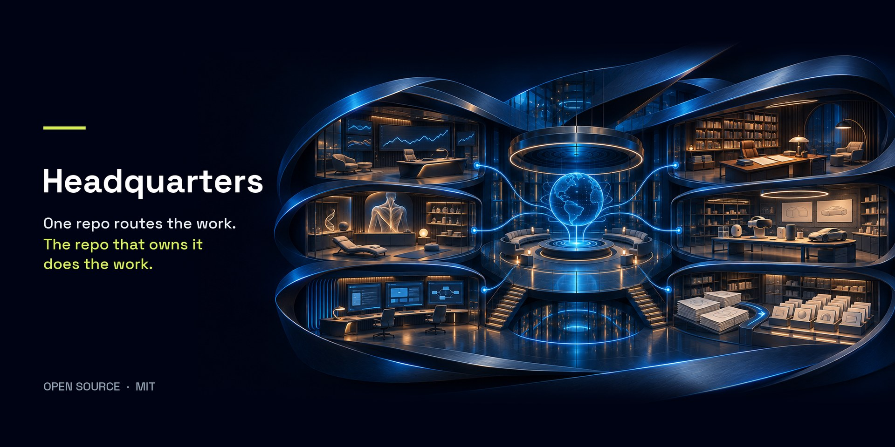

# Headquarters

**Headquarters routes the work. The repo that owns the work does it.**

Headquarters is one repo that runs all your other repos. It knows what you own,
decides where each job goes, sends an agent into the right repo to do it, and
holds the rules for what agents can do without asking you.

It works with Claude Code and Codex. It is a folder of plain files. There is no
server and nothing to host.

It carries no brand. Once it is set up it is your headquarters, and you can
call it whatever you want.

## Why it exists

If you run more than one codebase with AI agents, you are the wiring between
them. You carry decisions from one chat to the next, and every agent starts
cold.

Pointing one agent at all your repos fixes the map. It also creates a new
problem: an agent that can reach everything, with nothing telling it what it is
allowed to touch, whose rules apply, or when to stop and ask.

Headquarters is the answer I built for my own work, starting in January 2026.
I was a general foreman before I wrote software. A general foreman does not
pull the wire. He knows which crew owns which floor, what is released, what is
waiting on an answer, and what nobody touches until it is signed off. That is
the job this repo does.

## The seven rules

1. **Headquarters routes. The owning repo builds.** HQ never edits product
   code. It sends a worker into the repo that owns the work, under that repo's
   own rules.
2. **One registry says who owns what.** Every repo, its job, and how it
   releases, in one file.
3. **Permission lives in one place.** Today's request is authorized. Longer
   work sits in one queue. Old chats and old plans are history.
4. **Look at the live repo before you say what it can do.** HQ notes are
   pointers. Claims come from the code, read now.
5. **Prove it where it gets used.** Done means the thing that consumes the
   change accepted it.
6. **Some doors only you open.** Money, production, secrets, deletions, and
   anything sent outside wait for your yes.
7. **Decisions arrive prepared.** One question, one recommendation, the
   evidence attached.

## Start in two minutes

```bash
git clone https://github.com/BTCElectrician/headquarters.git
```

Open Claude Code or Codex in the folder and say:

> Set up my headquarters.

The agent asks where your repos live, reads them, fills in the registry, and
writes your first status file. It asks before it adds anything to your other
repos.

Want to see it run first? `examples/three-repo-shop/` is a made-up portfolio
you can try the whole loop on.

You need `git`, `bash`, and Python 3.9 or newer. There are no packages to
install.

## What is in the box

| File | What it does |
|------|--------------|
| `AGENTS.md` | The headquarters contract. The seven rules, written for agents. |
| `SETUP.md` | The script your agent follows when you say "Set up my headquarters." |
| `hq.yaml` | The registry of your repos. |
| `docs/STATUS.md` | Where things stand right now. |
| `docs/WORK_QUEUE.md` | The one record of authorized multi-day work. |
| `docs/OPERATOR_DECISIONS.md` | What is waiting on you, each with a recommendation. |
| `templates/` | The starter rules each of your repos gets, and the brief HQ hands a worker. |
| `ops/` | Small scripts: status across every repo, live-repo checks, and validators that keep the rules honest. |
| `examples/three-repo-shop/` | A made-up app, API and docs site to practice on. |

Three rules have checks that fail loudly when broken: the registry (rule 2),
the work queue (rule 3) and the decisions list (rule 7). Rule 4 has a helper,
`ops/repo_context.py`, that pulls live facts from a repo before anyone makes a
claim about it, and a docs check flags headquarters pages that have gone stale
or that nothing links to. Rules 1, 5 and 6 are instructions agents follow; no
script can enforce them from here. `ops/check_all.sh` runs every check at
once.

## Where this came from

I started the first version on January 31, 2026, to run the repos behind
[Ohmni Oracle](https://ohmnioracle.com). Every rule above was added after
something went wrong without it. The dated timeline is in
[docs/HISTORY.md](docs/HISTORY.md), and the thinking behind the name is in
[docs/WHY_HEADQUARTERS.md](docs/WHY_HEADQUARTERS.md).

A lot of people are talking about the home repo now: one repo that points at
all the others. That gives the agent a map. What it misses is everything that
happens once the agent can reach all of it, and that is what these rules are
for. I have been running this one, and improving it, since that first commit.

## License

MIT. Take it, rename it, change the rules to fit how you run work.

Built by [Collin Velarde](https://collinvelarde.com), AI Engineer for
Construction and founder of Ohmni Oracle.
